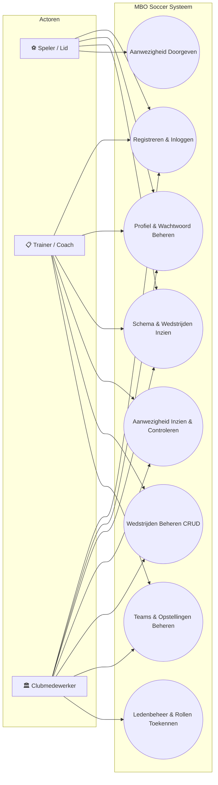

# Projectdocument MBO SOCCER
**Vak:** Webdev 3 – OOP 1  
**Project:** Voetbalvereniging MBO Soccer Clubportaal  
**Methode:** SCRUM (9-weken cyclus)  

---

## 1. Projectbeschrijving
Voetbalvereniging **MBO Soccer** wil een betrouwbaar en gebruiksvriendelijk digitaal systeem waarmee:
- Leden zich online kunnen inschrijven en hun account kunnen beheren.
- Spelers en trainers realtime inzicht hebben in trainingsschema’s en wedstrijdprogramma's.
- Spelers eenvoudig hun beschikbaarheid ('wel/niet aanwezig') kunnen doorgeven voor wedstrijden.
- Clubmedewerkers en trainers wedstrijden kunnen plannen, teams en opstellingen kunnen beheren en overzicht houden op de opkomst.
- Gegevens veilig worden opgeslagen conform moderne webstandaarden (PHP PDO met prepared statements tegen SQL-injectie, sessiebeveiliging en bescherming tegen XSS).

---

## 2. User Stories & Acceptatiecriteria (MoSCoW)

### Epic 1: Ledenervaring (Spelers & Trainers)

#### US-01: Zelfregistratie en Accountbeheer (Must Have)
- **Als** potentiële speler,  
  **wil ik** mezelf online kunnen inschrijven bij MBO Soccer en mijn profielgegevens kunnen bijwerken,  
  **zodat** mijn contactgegevens bekend zijn bij de club en ik toegang krijg tot het portaal.  
- **Acceptatiecriteria:**
  - *Given* dat ik een bezoeker ben op de registratiepagina,  
    *When* ik mijn naam, e-mailadres en een wachtwoord van minimaal 6 tekens invoer,  
    *Then* wordt mijn account aangemaakt met de rol `lid` en word ik direct ingelogd.
  - *Given* dat ik ben ingelogd,  
    *When* ik naar mijn profiel ga,  
    *Then* kan ik mijn telefoonnummer, geboortedatum en eventueel een nieuw wachtwoord opslaan.

#### US-02: Programma & Schema Inzien (Must Have)
- **Als** speler of trainer,  
  **wil ik** een overzicht zien van aankomende wedstrijden en trainingen,  
  **zodat** ik weet wanneer en op welk veld ik moet spelen of trainen.  
- **Acceptatiecriteria:**
  - *Given* dat ik de pagina `/schedule.php` open,  
    *Then* zie ik een lijst van wedstrijden met datum/tijd, team, tegenstander, thuis/uit en veldnummer.
  - *Given* dat ik zoek in het zoekveld,  
    *Then* filtert de tabel direct zonder pagina-herlaad.

#### US-03: Beschikbaarheid Doorgeven (Must Have)
- **Als** selectiespeler,  
  **wil ik** per wedstrijd direct kunnen aangeven of ik 'wel' of 'niet' aanwezig ben,  
  **zodat** de trainer weet op wie hij kan rekenen bij het maken van de opstelling.  
- **Acceptatiecriteria:**
  - *Given* dat ik ben ingelogd als lid,  
    *When* ik op de knop '✓ Wel' of '✕ Niet' klik bij een wedstrijd,  
    *Then* wordt mijn status via een asynchrone request (AJAX/Fetch) direct opgeslagen en toont de badge mijn status.

---

### Epic 2: Beheerderservaring (Clubmedewerkers & Trainers)

#### US-04: Wedstrijdbeheer (CRUD) (Must Have)
- **Als** clubmedewerker,  
  **wil ik** wedstrijden kunnen toevoegen, wijzigen en verwijderen,  
  **zodat** het speelschema altijd up-to-date is voor de gehele vereniging.  
- **Acceptatiecriteria:**
  - *Given* dat ik ben ingelogd als medewerker,  
    *When* ik een formulier invul met tegenstander, datum/tijd, veld en thuis/uit,  
    *Then* wordt de wedstrijd opgeslagen in de database via PDO prepared statements.
  - *Given* dat een wedstrijd afgelast is,  
    *When* ik op verwijderen of status 'Afgelast' klik,  
    *Then* wordt dit correct verwerkt in het systeem.

#### US-05: Teams & Opstellingen Beheren (Should Have)
- **Als** trainer of medewerker,  
  **wil ik** spelers kunnen toewijzen aan teams met hun positie en rugnummer,  
  **zodat** de teamsamenstelling helder is.  
- **Acceptatiecriteria:**
  - *Given* dat ik een team selecteer in `/admin/teams.php`,  
    *When* ik een geregistreerd lid selecteer en een positie/rugnummer toeken,  
    *Then* verschijnt deze speler in de selectielijst van het team.

#### US-06: Inzicht in Aanwezigheid (Must Have)
- **Als** trainer,  
  **wil ik** per wedstrijd zien welke spelers aanwezig of afgemeld zijn,  
  **zodat** ik een representatieve opstelling kan formeren.  
- **Acceptatiecriteria:**
  - *Given* dat ik op `/admin/attendance.php` een wedstrijd kies,  
    *Then* zie ik tellers (Aanwezig, Afgemeld, Onbekend) en een gedetailleerde lijst van alle teamleden met hun status.

#### US-07: Ledenbeheer & Rollen (Must Have)
- **Als** clubmedewerker,  
  **wil ik** leden kunnen beheren en rollen (`lid`, `trainer`, `medewerker`) kunnen toekennen,  
  **zodat** alleen geautoriseerde personen beheertaken kunnen uitvoeren.

---

## 3. Narratives (Gebruikersverhalen & Persona's)

### Persona 1: Sem Jansen (Speler, 19 jaar, MBO Student)
> *"Op zaterdagochtend wil ik niet hoeven appen in een drukke groepsapp om te checken hoe laat we verzamelen. Ik open de MBO Soccer app op mijn telefoon, zie meteen dat we om 14:30 thuis spelen op Veld 1 tegen FC Tech United, en met één tik op '✓ Wel' weet mijn coach dat ik er sta."*

### Persona 2: Dennis van Dijk (Trainer / Coach MBO Soccer 1)
> *"Als trainer wil ik op donderdagavond na de training de knoop doorhakken over de basisopstelling. In het beheerdersportaal zie ik in één oogopslag dat 14 spelers aanwezig zijn en 2 geblesseerd afgemeld. Hierdoor kan ik direct de juiste formatie bepalen en de tactiek voorbereiden."*

### Persona 3: Linda de Ruiter (Clubsecretaris & Medewerker)
> *"Aan het begin van het seizoen moeten er tientallen nieuwe aanmeldingen verwerkt worden en moeten competitiewedstrijden worden ingepland op de juiste velden. Met het MBO Soccer portaal voer ik eenvoudig nieuwe wedstrijden in en beheer ik alle leden en hun rollen veilig op één centrale plek."*

---

## 4. Use Case Diagram



---

## 5. Sitemap & Navigatiestructuur

```
VV MBO Soccer (Sitemap)
│
├── 🌐 Publiek / Alle Bezoekers
│   ├── /index.php               (Homepage, visual hero, uitslagen/stats, clubinfo)
│   ├── /schedule.php            (Wedstrijd- en trainingskalender)
│   ├── /login.php               (Inlogportaal)
│   └── /register.php            (Nieuwe leden inschrijving)
│
├── 👤 Ingelogd Lid / Speler
│   ├── /profile.php             (Accountbeheer, persoonlijke gegevens, teamindeling)
│   ├── /schedule.php            (Met interactieve knoppen: '✓ Wel / ✕ Niet Aanwezig')
│   ├── /api/set_attendance.php  (Async JSON endpoint voor aanwezigheidsupdate)
│   └── /logout.php              (Veilige sessievernietiging)
│
└── 🔒 Beheerdersomgeving (Trainer / Clubmedewerker)
    ├── /admin/dashboard.php     (KPI's, snelkoppelingen, overzicht komende duels)
    ├── /admin/matches.php       (Wedstrijden toevoegen, wijzigen, verwijderen)
    ├── /admin/teams.php         (Teambeheer, spelers toevoegen, rugnummers, posities)
    ├── /admin/attendance.php    (Aanwezigheidsoverzicht per wedstrijd, export/tellingen)
    └── /admin/members.php       (Ledenlijst CRUD, rollen wijzigen - Alleen Medewerker)
```

---

## 6. Visual Design Specificatie (Homepage)

- **Huisstijl & Kleurenpalet:**
  - *Primary Green:* `#10b981` (Grasgroen / sportief)
  - *Primary Dark:* `#059669` (Diepgroen voor hover en accenten)
  - *Secondary Navy:* `#0f172a` (Donkerblauw / betrouwbare clubidentiteit)
  - *Background:* `#f8fafc` (Lichtgrijs / strak en overzichtelijk)
  - *Accent Gold:* `#f59e0b` (Voor badges, trofeeën en speciale aankondigingen)
  - *Alerts:* `#fee2e2` / `#ef4444` (Afwezig / foutmeldingen)
- **Typografie:**
  - Font family: `Plus Jakarta Sans`, modern sans-serif met uitstekende leesbaarheid op mobiel en desktop.
  - Headings: 700 / 800 bold gewichten met strakke letterspacing.
- **Componenten:**
  - Hero banner met gradient en directe call-to-actions voor inschrijven en schema inzien.
  - Live KPI-tegels (leden, teams, wedstrijden).
  - Interactieve datatabellen met responsieve scroll en live zoekfilter.

---

## 7. Wireframes van alle Pagina's (UI Layouts)

### 7.1 Homepage (`/index.php`)
```
+------------------------------------------------------------------------+
| ⚽ MBO SOCCER           Home   Programma   Inloggen   [Lid Worden]     |
+------------------------------------------------------------------------+
| [ HERO BANNER ]                                                        |
|   Seizoen 2026/2027                                                    |
|   Verenigd door Voetbal, Gedreven door Passie                          |
|   [Word nu lid]  [Direct Inloggen]                                     |
+------------------------------------------------------------------------+
| [ 👥 6 Leden ]   [ 🏆 2 Teams ]   [ 📅 3 Wedstrijden ]   [ ⚡ 100% OOP ] |
+------------------------------------+-----------------------------------+
| ⚽ Eerstvolgende Wedstrijden        | 📋 Onze Teams                     |
| 28-09 | MBO 1 vs Tech United (Thuis)| MBO Soccer 1 | Senioren | 4 spelers|
| 05-10 | MBO 1 vs Dev Stars  (Uit)  | MBO O19-1    | Jeugd    | 1 speler |
+------------------------------------+-----------------------------------+
| FOOTER: Links, Locatie & Contactgegevens                               |
+------------------------------------------------------------------------+
```

### 7.2 Programma & Aanwezigheid (`/schedule.php`)
```
+------------------------------------------------------------------------+
| ⚽ MBO SOCCER      Home   Programma   Mijn Profiel   Beheer ▾  [Uitloggen]
+------------------------------------------------------------------------+
| Wedstrijd- & Trainingsschema                    [ 🔍 Zoekfilter...   ] |
+------------------------------------------------------------------------+
| Datum      | Team     | Tegenstander | Locatie | Veld | Mijn Aanwezigheid|
| 28-09 14:00| MBO 1    | Tech United  | Thuis   | Veld1| [✓ Wel] [✕ Niet] |
| 05-10 15:00| MBO 1    | Dev Stars    | Uit     | Sport| [✓ Wel] [✕ Niet] |
+------------------------------------------------------------------------+
| 🏃 Trainingsschema                                                     |
| Woensdag 19:30 | MBO 1 | Veld 2 | Positiespel en afronden op goal      |
+------------------------------------------------------------------------+
```

### 7.3 Beheerdersdashboard (`/admin/dashboard.php`)
```
+------------------------------------------------------------------------+
| ⚽ MBO SOCCER (Beheer)     Dashboard   Wedstrijden   Teams   Leden     |
+------------------------------------------------------------------------+
| Beheerdersoverzicht                    [+ Wedstrijd Plannen] [👥 Leden]|
| [ 6 Geregistreerde Leden ]  [ 2 Teams ]  [ 3 Wedstrijden ]             |
+------------------------------------------------------------------------+
| ⚽ Komende Wedstrijden                 | 🏆 Teams & Selecties           |
| • MBO 1 vs Tech United -> [Spelers 👥] | • MBO Soccer 1 (4 spelers)     |
| • MBO 1 vs Dev Stars   -> [Spelers 👥] | • MBO O19-1 (1 speler)         |
+------------------------------------------------------------------------+
```

### 7.4 Aanwezigheidsmonitor (`/admin/attendance.php`)
```
+------------------------------------------------------------------------+
| Wedstrijd selecteren: [ 28-09 | MBO 1 vs FC Tech United (Thuis)   ▾ ]  |
+------------------------------------------------------------------------+
| [ ✓ 2 Spelers Aanwezig ]    [ ✕ 1 Afgemeld ]    [ ? 1 Onbekend ]       |
+------------------------------------------------------------------------+
| Rugnr | Spelersnaam   | Positie     | Status        | Reden            |
| #9    | Sem Jansen    | Aanvaller   | [✓ Aanwezig]  | Fit voor aftrap  |
| #8    | Liam de Boer  | Middenveld  | [✕ Afwezig]   | Enkelblessure    |
| #4    | Milan Bakker  | Verdediger  | [✓ Aanwezig]  | -                |
+------------------------------------------------------------------------+
```

---

## 8. Beveiliging en Kwaliteitsborging

1. **SQL-Injectie Preventie:**
   - Geen dynamische query-concatenatie (`"SELECT * WHERE id = " . $id`).
   - Consequent gebruik van `PDO::prepare()` en gebonden parameters (`:id`, `:email`).
   - `PDO::ATTR_EMULATE_PREPARES => false` afgedwongen.
2. **XSS (Cross-Site Scripting) Preventie:**
   - Alle gebruikersinvoer wordt ge-escaped met `htmlspecialchars($val, ENT_QUOTES, 'UTF-8')` via de helperfunctie `e()`.
3. **Wachtwoordbeveiliging:**
   - Geen plain text opslag. Gebruik van het industriestandaard `password_hash($wachtwoord, PASSWORD_BCRYPT)` en verificatie via `password_verify()`.
4. **Autorisatie & Rollen:**
   - Pagina's in de `/admin/` map zijn strikt beschermd met `requireRole(['medewerker', 'trainer'])`.
   - Ledenbeheer is uitsluitend toegankelijk voor de rol `medewerker`.
